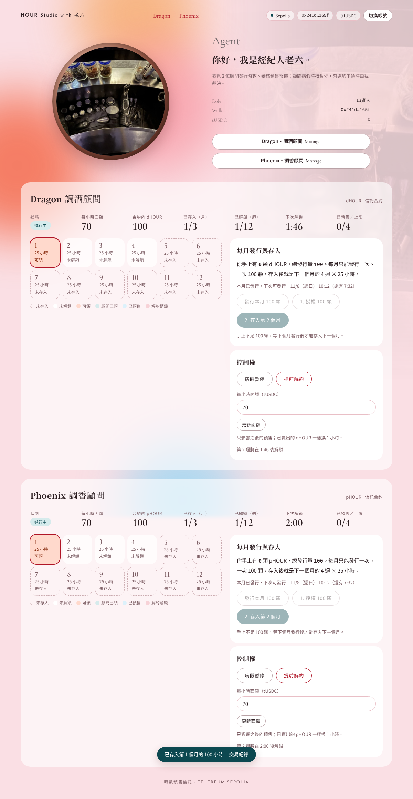
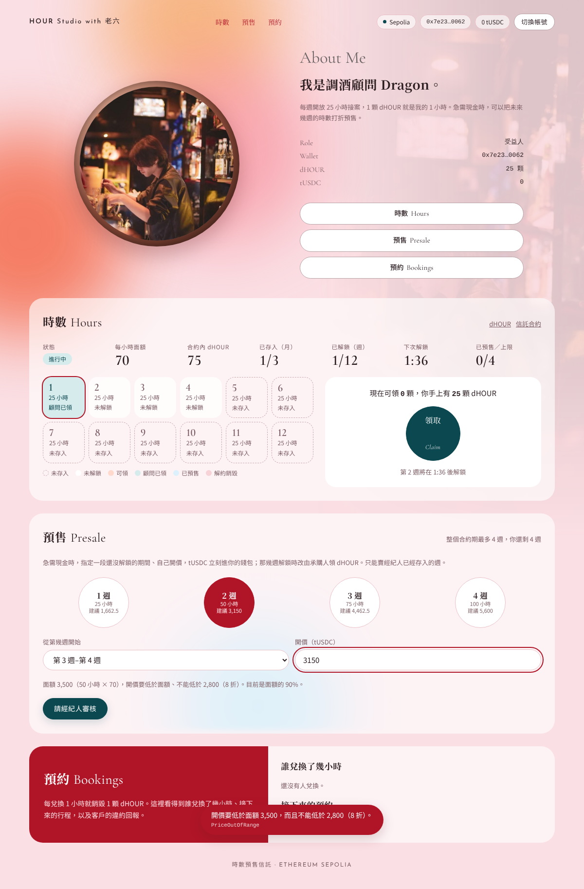
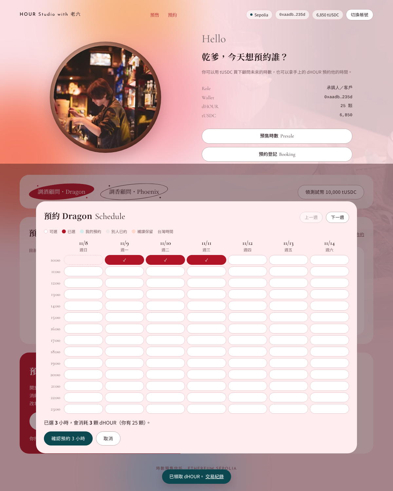
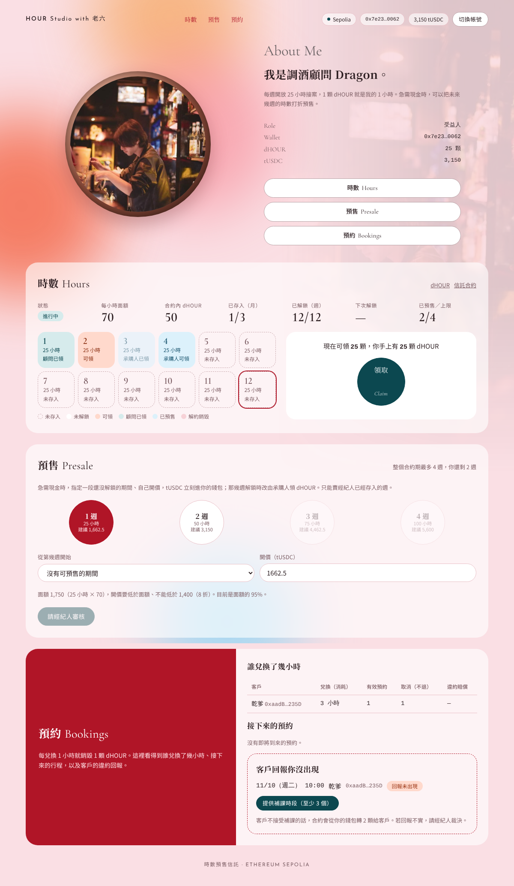
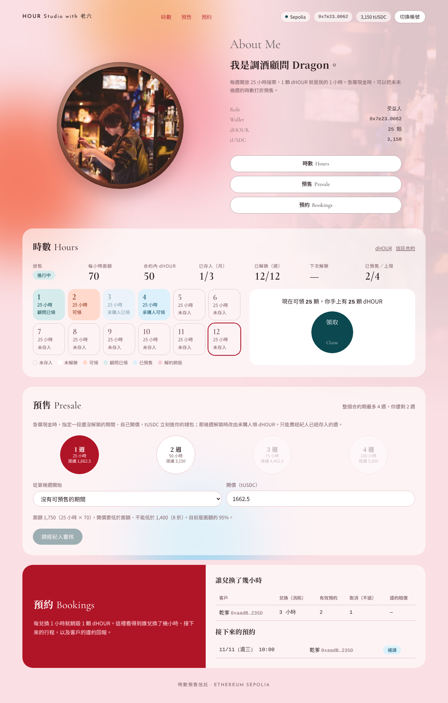

# 時數預售信託（$HOUR）

智能合約期中專案｜Ethereum Sepolia｜Solidity + 純 HTML 前端（ethers.js v6 + MetaMask）



## 一、專案介紹

顧問（例如調酒顧問、調香顧問）最值錢的是未來的工作時間，但時間要等到當週才能賣。本專案把顧問未來的時間做成代幣：**1 顆 $HOUR = 這位顧問 1 小時的服務**，每位顧問各有一種代幣（Dragon 是 `dHOUR`、Phoenix 是 `pHOUR`）和一份信託合約。

經紀人每個月發行 100 顆 $HOUR 存進信託，信託每週解鎖 25 小時：

- **15 小時進原價商店**：客戶用目前面額（70 tUSDC／小時）購買，錢直接付給顧問。
- **10 小時彈性時數**：顧問可以自己領，或打折預售未來 1–4 週，提前拿到現金（不得低於面額 8 折，需經紀人同意）。

客戶拿到 $HOUR 後在網頁上選時段預約（每天 10:00–24:00），預約幾小時就銷毀幾顆。顧問沒出現時，顧問要提出至少 3 個補課時段，客戶不接受就從顧問的準備金賠 2 顆。

## 二、角色

| 角色 | Demo 帳號 | 能做什麼 |
| --- | --- | --- |
| 出資人：經紀人 | 老六（1 個帳號管理兩位顧問） | 每月發行 100 顆、存入信託、審核預售報價、病假暫停、裁決違約爭議；和顧問雙方簽核調價、提前解約 |
| 受益人：顧問 | Dragon（調酒）、Phoenix（調香） | 領彈性時數、掛預售單、提出補課或改時間；和經紀人雙方簽核調價、提前解約 |
| 承購人：客戶 | 乾爹、乾媽，或任何其他帳號 | 在原價商店買時數、買折價預售、領 $HOUR、預約、回報顧問沒出現、轉讓 $HOUR |

## 三、主要規則（寫在合約裡）

| 規則 | 說明 |
| --- | --- |
| 發行 | 經紀人每個月只能發行一次 100 顆，沒有其他 mint 函式，decimals = 0 |
| 每週 25 小時 | 15 小時原價商店 + 10 小時彈性；合約期 12 週，一個月 4 週 |
| 折價預售 | 顧問指定第幾週起連續 1–4 週，開價低於面額、不低於 8 折；經紀人同意後上架；承購人付的 tUSDC 直接給顧問，那幾週解鎖後由承購人領 $HOUR |
| 調價 | 2-of-2：一方提出、另一方確認才生效；已賣出的 $HOUR 一樣換 1 小時 |
| 提前解約 | 2-of-2；未解鎖、未賣出的時數銷毀，已賣出的仍屬承購人 |
| 病假暫停 | 經紀人暫停後，不能新預約、不能買，已賣出的權利不受影響 |
| 預約 | 整點、未來 30 天內、台灣時間 10:00–24:00；取消不退代幣 |
| 顧問沒出現 | 顧問提出 ≥3 個補課時段，客戶選一個或拒絕；拒絕則從顧問錢包賠 2 顆（不足由經紀人代賠）；有爭議由經紀人裁決 |
| 顧問準備金 | 顧問錢包最多留 10 顆，多的銷毀；顧問不能轉出代幣，避免私下低價賣出 |
| 不合法操作 | 全部用 custom error 擋下（例如 `PriceOutOfRange`、`InsiderCannotBuy`、`SlotTaken`），前端翻成中文說明 |

Demo 為了能在課堂上看到時間流動：一「週」= 120 秒、一「個月」= 480 秒（部署參數可改）。

## 四、已部署合約（Sepolia，Etherscan 已驗證）

| 合約 | 地址 |
| --- | --- |
| Dragon HourToken（dHOUR） | [`0x3D9C929F0Cb7Bc9C1eCB19dBa330423d8Db3dB36`](https://sepolia.etherscan.io/address/0x3D9C929F0Cb7Bc9C1eCB19dBa330423d8Db3dB36#code) |
| Dragon HourTrust | [`0xdcC4e3118d6840C65473dfD1877A05EEAFb33160`](https://sepolia.etherscan.io/address/0xdcC4e3118d6840C65473dfD1877A05EEAFb33160#code) |
| Phoenix HourToken（pHOUR） | [`0x8668eAD423c22898d85c073DAA263f25c21edf37`](https://sepolia.etherscan.io/address/0x8668eAD423c22898d85c073DAA263f25c21edf37#code) |
| Phoenix HourTrust | [`0x8F36B835D1FE803a623ca37d7a568bB30e4f35b7`](https://sepolia.etherscan.io/address/0x8F36B835D1FE803a623ca37d7a568bB30e4f35b7#code) |
| tUSDC（MockUSDC，6 位小數） | [`0x0B8E8FFD77c8c14fDF185CC031d004Ec38B23566`](https://sepolia.etherscan.io/address/0x0B8E8FFD77c8c14fDF185CC031d004Ec38B23566#code) |

網路：Ethereum Sepolia（Chain ID 11155111）。編譯：Solidity 0.8.34，Optimizer 200 runs，OpenZeppelin Contracts 5。

## 五、檔案結構

```
contracts/HourToken.sol    $HOUR 代幣（ERC-20）+ 預約、取消、補課、違約賠償
contracts/HourTrust.sol    時數信託（每位顧問一份）：存入、原價商店、彈性時數、折價預售、調價、解約
contracts/MockUSDC.sol     測試用 tUSDC（6 位小數）
frontend/index.html        單一 HTML 前端，依連線帳號自動顯示經紀人／顧問／客戶畫面
frontend/img/              前端用的照片
test/test.js               合約單元測試（138 項，本機 ganache）
test/e2e.js                前端端到端測試（Playwright 實際操作網頁並截圖）
docs/部署教學.md            Remix + MetaMask 從頭部署的逐步教學
docs/screenshots/          操作截圖
docs/slides/               期中報告簡報
```

## 六、開啟前端

前端需要透過 http 開啟（MetaMask 不支援 `file://`）。

```bash
cd frontend
python -m http.server 8000
```

1. 用裝有 MetaMask 的瀏覽器開 `http://localhost:8000`，網路切到 Sepolia。
2. 按「連接錢包」。網頁會依帳號身分顯示對應畫面：經紀人看到兩位顧問的總覽，顧問看到自己的帳本，其他帳號看到客戶市集與預約。
3. 想用自己部署的合約，改 `frontend/index.html` 上方 `CONFIG.consultants` 的地址即可。

## 七、部署（Remix）

完整步驟見 [docs/部署教學.md](docs/部署教學.md)。摘要：

1. Remix 新增 `HourToken.sol`、`HourTrust.sol`，Compiler 0.8.34、Optimization 200 runs。
2. Environment 選 Browser Extension（MetaMask），切到經紀人帳號。
3. 每位顧問部署一份 `HourToken(name_, symbol_, agency_, consultant_, consultantName_, monthLength_)`，例如 `Dragon Hour, dHOUR, 經紀人地址, 顧問地址, Dragon, 480`。
4. 再部署對應的 `HourTrust(hour_, usdc_, consultantName_, 25, 15, 12, 4, 70000000, 120)`。
5. 把地址填進前端 `CONFIG`，到 Etherscan 驗證。

## 八、測試

需要 Node.js 18 以上。

```bash
npm install
npm test          # 編譯合約並跑 138 項單元測試
```

前端端到端測試另外需要 `playwright`、本機 ganache（chainId 11155111）與在 :8000 開啟 `frontend/` 的 http server：

```bash
node test/e2e.js <截圖輸出資料夾>
```

## 九、操作截圖

| 顧問掛預售單 | 客戶市集 | 預約時段 |
| --- | --- | --- |
|  |  |  |

| 客戶回報沒出現後的顧問帳本 | 客戶選補課時段 | 補課成立後的顧問畫面 |
| --- | --- | --- |
|  |  |  |

## 十、安全提醒

- 只使用 Sepolia 測試資產，請另外建立測試專用的 MetaMask 錢包。
- 私鑰、助記詞不要放進程式碼或上傳到 GitHub（本 repo 不含任何私鑰）。
